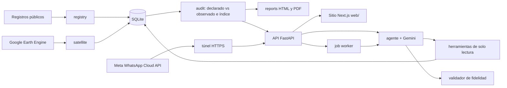

# Arquitectura

## Módulos de `backend/src/bosquevivo`

| Módulo | Responsabilidad | Requisitos |
|---|---|---|
| `core` | Configuración, logging, errores, privacidad | |
| `db` | Modelos y sesión SQLite | |
| `registry` | Importación y validación de polígonos | RF01 |
| `satellite` | Series, NDVI, pérdida forestal, miniaturas | RF02, RF03 |
| `audit` | Comparación, índice, confianza, narrativa | RF04, RF05 |
| `reports` | Reportes HTML y PDF | RF06 |
| `assistant` | WhatsApp, consentimiento, voz | RF07, RF08, RF12, RF13 |
| `ai` | Agente, herramientas, guardas, conocimiento, visión, evaluación | RF09, RF10, RF15, RF17 |
| `jobs` | Cola y trabajador en segundo plano | |
| `api` | Routers REST y webhook | |

## Frontend (`web/`)

Sitio Next.js (App Router). El navegador solo habla con el servidor de Next, que llama a la API con `ADMIN_TOKEN` cuando hace falta (chat y trazas), por eso la API no necesita CORS. Las respuestas se validan con zod en `web/src/lib/api/schema.ts`. Detalle y decisión en la [ADR 0013](adr/0013-nextjs-para-el-frontend.md); pedidos pendientes al backend en [`solicitudes-al-backend.md`](solicitudes-al-backend.md).

## Fronteras

- `api → servicios → db`.
- El agente solo invoca herramientas registradas y esas herramientas solo leen. `solicitar_calculo` y `generar_reporte` encolan trabajos y están restringidas al rol auditor.
- Nada en `ai/` escribe resultados de auditoría.
